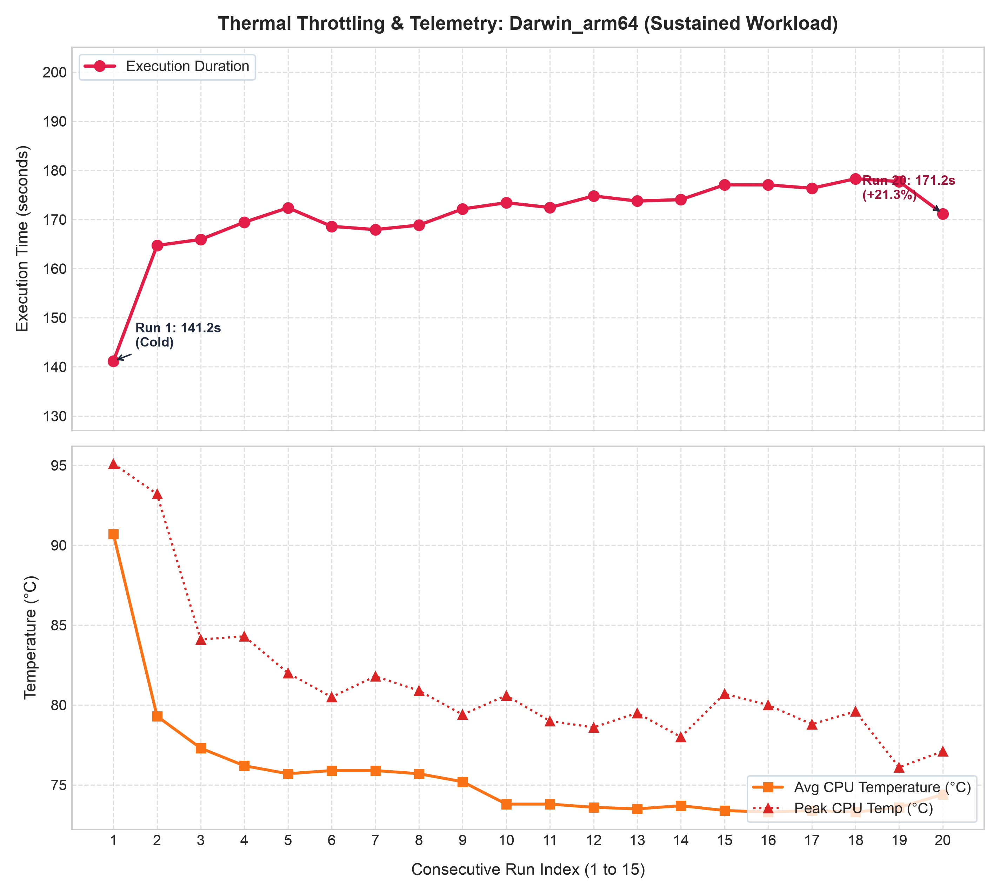
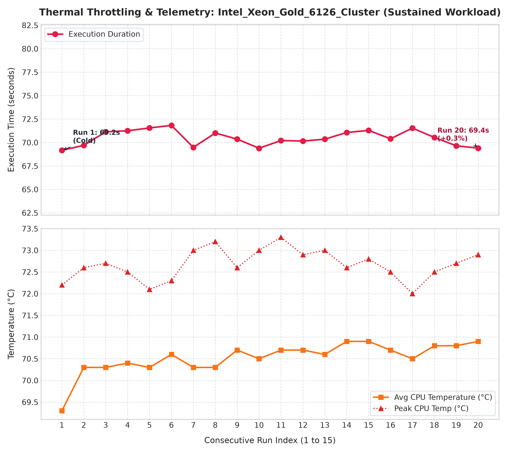
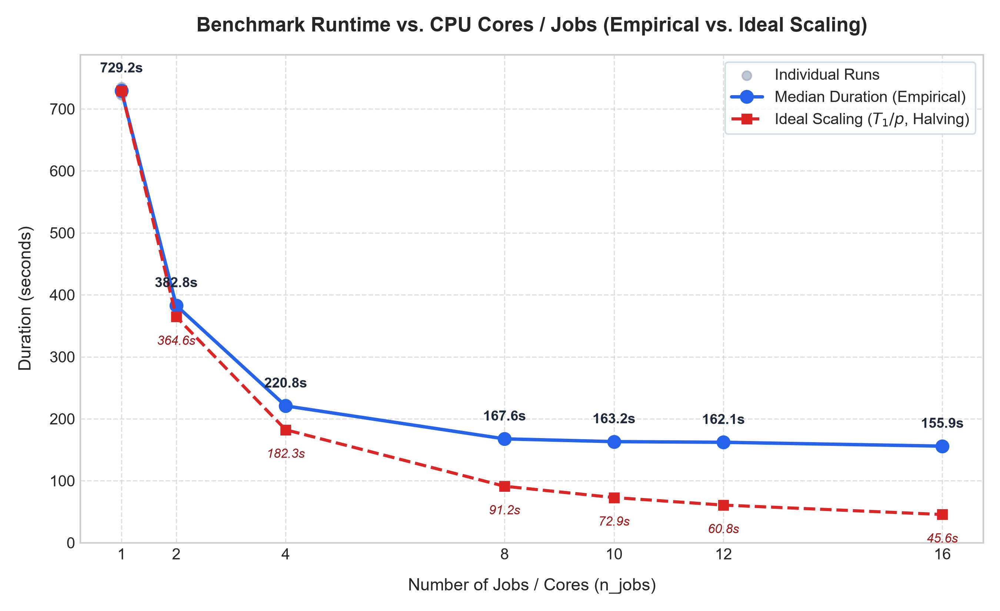
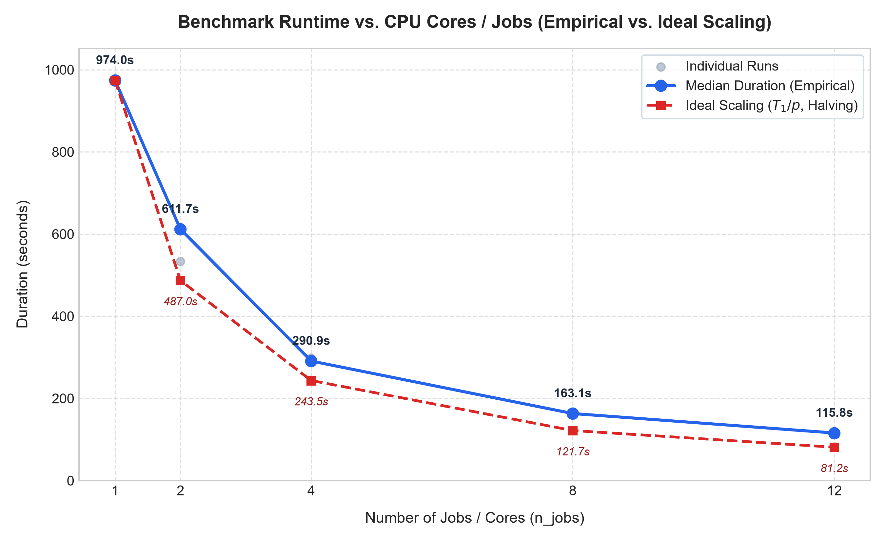
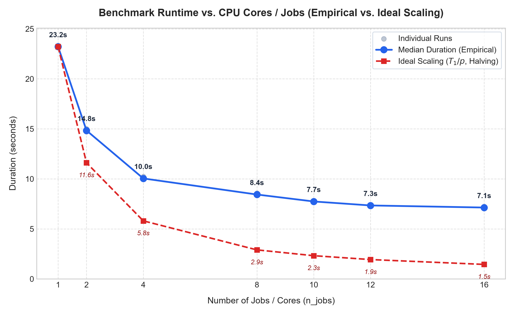
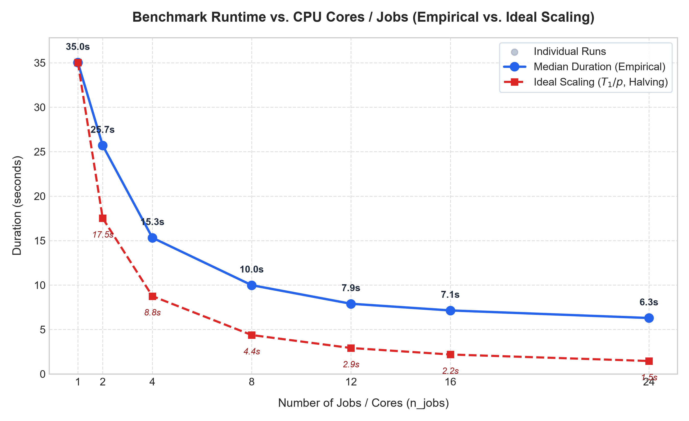
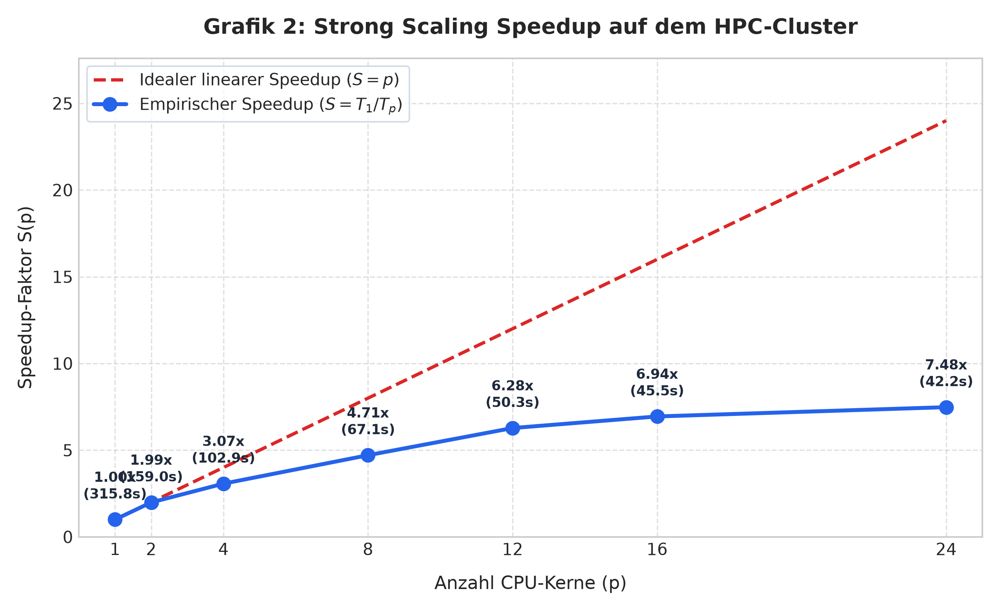
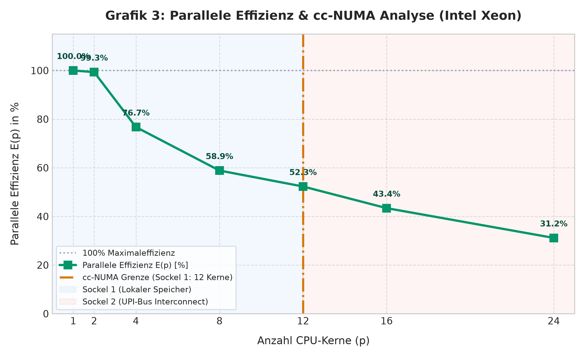
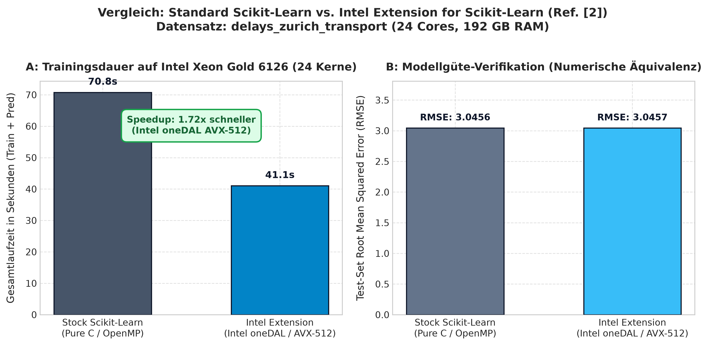

# When is an HPC cluster worth it? Benchmarking a Slurm node against an Apple M4 laptop

I benchmarked machine-learning workloads on a university HPC node (dual-socket Intel Xeon, 24 cores, 192 GB RAM, Slurm) and on my own MacBook (Apple M4, 10 cores, 24 GB). The goal was to find out **where the cluster actually pays off**, and where it doesn't. The questions were how well each workload scales, where efficiency drops, and which hardware effects matter.

Written as part of a university HPC course. The parallelisation framework I focused on was **IPyParallel**.

## Key findings

| # | Finding | Evidence |
|---|---------|----------|
| 1 | **The laptop throttles, the server doesn't.** Under sustained load the M4 gets 26 % slower; the Xeon stays flat. | 20 consecutive 5.5M-row training runs: M4 141 s → 178 s (+26.3 %), clock 3.57 → 1.67 GHz. Xeon 69.2 s → 69.4 s (+0.3 %) at a steady ~3.5 GHz. |
| 2 | **One laptop core beats one cluster core.** The cluster wins through core count, not per-core speed. | Random Forest, 1 core: M4 729 s vs Xeon 974 s. |
| 3 | **Parallel efficiency falls quickly, and it depends on the algorithm.** | At the same 12 Xeon cores: Random Forest reaches 8.4× (70 % efficiency), XGBoost only 4.4× (37 %), because it becomes memory-bound sooner. XGBoost at 24 cores: 5.6× (23 %). |
| 4 | **Crossing the CPU-socket boundary costs efficiency.** | IPyParallel task farm: efficiency 52 % at 12 cores (one socket), 43 % at 16, 31 % at 24 (both sockets). |
| 5 | **Optimise before you scale.** Hardware-aware libraries can beat adding cores. | Intel oneDAL (AVX-512) via `scikit-learn-intelex`: **1.72× faster** Random Forest with a one-line patch and the same RMSE. |
| 6 | **Hidden thread oversubscription silently ruins measurements.** | My first XGBoost "scaling" run was flat at 35 s for 1–24 cores. XGBoost ignored the core limit and used all 24 threads every time. After pinning threads: 35.0 s → 6.3 s. |
| 7 | **Queue latency is part of the cost.** | An 8-second smoke-test job was scheduled ~7.5 h after submission. The cluster only pays off for long jobs. |

**Takeaway:** use the cluster for long, stable, memory-hungry, or embarrassingly parallel work (sweeps, ensembles), and use 8–12 cores rather than the whole node. Use the laptop for short or interactive jobs. For the 24-core XGBoost case here, the laptop's best time (7.1 s) was within about 13 % of the full cluster node (6.3 s).

## Setup

- **Dataset:** [OpenML 45034](https://www.openml.org/d/45034), Zurich public-transport delays. 5,465,575 rows, 8 numeric features, regression target is the delay in minutes. Compressed Parquet is ~24 MB; it expands to ~393 MB in RAM.
- **Models:** `RandomForestRegressor` (100 trees, depth 15) and `XGBRegressor` (`tree_method="hist"`, 100 trees, depth 8). 80/20 train/test split, seed 42.
- **Metric:** wall-clock training time (median of 3–4 repeats). Speedup is S(p) = T₁/Tₚ and efficiency is E(p) = S(p)/p.
- **The models are a workload, not the point.** R² is only ≈ 0.045 because delays are mostly stochastic. The question is how the compute scales, not how good the predictor is. The actual performance of the models was not a metric that mattered for this experiment, a model that has R² = 0.8 does not use a CPU differently than one with R² = 0.045.

| | Laptop | Cluster node |
|---|---|---|
| CPU | Apple M4, 10 cores | 2 × Intel Xeon Gold 6226 (Cascade Lake), 24 cores, AVX-512 |
| RAM | 24 GB unified | 192 GB, two NUMA domains |
| Python | 3.x, macOS | 3.10, Slurm batch jobs |

## Results

### 1. Thermal throttling: laptop vs. server

20 back-to-back Random Forest trainings with CPU temperature and clock sampled every second.

| | Run 1 (cold) | Run 20 (sustained) | Change | Clock |
|---|---|---|---|---|
| Apple M4 (10 cores) | 141.2 s | 171.2 s (peak: 178.3 s at run 18) | **+26.3 %** | 3.57 → 1.67 GHz |
| Xeon node (24 cores) | 69.2 s | 69.4 s | **+0.3 %** | 3.51 → 3.50 GHz |

<p align="center">
  
  
</p>

### 2. Single-model scaling (shared memory)

Full dataset, one model, `n_jobs = p`.

**Random Forest**

| Cores | Laptop | Speedup | Cluster | Speedup |
|---|---|---|---|---|
| 1 | 729 s | 1.0× | 974 s | 1.0× |
| 4 | 221 s | 3.3× | 291 s | 3.4× |
| 8 | 168 s | 4.4× | 163 s | 6.0× |
| 12 | 162 s | 4.5× | 116 s | 8.4× |
| 16 | 156 s | 4.7× | n/a | n/a |

The cluster sweep was only completed up to 12 cores; the job hit its time limit. The laptop flattens out after about 4 cores, which is consistent with memory-bandwidth limits and shared performance/efficiency core resources. The cluster keeps scaling. With 12 cores it is already faster than the laptop's best result.

**XGBoost (histogram)**

| Cores | Laptop | Speedup | Cluster | Speedup |
|---|---|---|---|---|
| 1 | 23.2 s | 1.0× | 35.0 s | 1.0× |
| 4 | 10.0 s | 2.3× | 15.3 s | 2.3× |
| 8 | 8.4 s | 2.8× | 10.0 s | 3.5× |
| 12 | 7.3 s | 3.2× | 7.9 s | 4.4× |
| 16 | 7.1 s | 3.3× | 7.1 s | 4.9× |
| 24 | n/a | n/a | 6.3 s | 5.6× |

XGBoost is ~30× faster than Random Forest on one core and becomes memory-bound early. Past 8 cores the extra silicon barely helps.

<p align="center">
  
  
</p>
<p align="center">
  
  
</p>

### 3. Task parallelism with IPyParallel

The shared-memory runs scale a single model. To use all 24 cores on a more realistic workload, I distributed **24 independent model-training tasks** (a Random Forest and XGBoost grid on a 500k-row sample) across 24 IPyParallel engines, one per core, with a `LoadBalancedView`. Strong scaling:

| Cores | Time | Speedup | Efficiency |
|---|---|---|---|
| 1 | 315.8 s | 1.00× | 100 % |
| 2 | 159.0 s | 1.99× | 99 % |
| 4 | 102.9 s | 3.07× | 77 % |
| 8 | 67.1 s | 4.71× | 59 % |
| 12 | 50.3 s | 6.28× | 52 % |
| 16 | 45.5 s | 6.94× | 43 % |
| 24 | 42.2 s | 7.48× | 31 % |

<p align="center">
  
  
</p>

Two effects limit scaling:

- **Socket boundary.** Up to 12 cores everything runs on one CPU socket. Beyond that, engines also run on the second socket, and the efficiency curve bends further. Cross-socket traffic over the interconnect is the likely cause, but I did not isolate it with NUMA counters, so treat it as a hypothesis.
- **Stragglers.** With heterogeneous tasks the slowest one (~38 s) sets a lower bound on the runtime, so the extra cores sit idle. The sweet spot for this workload was **8–12 cores**.

**Parallel voting ensemble.** 8 models (4 Random Forest + 4 XGBoost) trained in parallel in **62.6 s** instead of 232.3 s sequentially (**3.7×**, bounded by the slowest sub-model). The ensemble RMSE of 3.065 was marginally better than the individual models (3.064–3.070), a difference within the noise I'd expect from model variation.

### 4. Software Optimization before Hardware: AVX-512 via oneDAL

Adding `from sklearnex import patch_sklearn; patch_sklearn()` to the Random Forest on all 24 cores:

| | Train + predict | RMSE |
|---|---|---|
| Stock scikit-learn | 70.8 s | 3.0457 |
| Intel Extension (oneDAL / AVX-512) | 41.1 s | 3.0457 |

That's **1.72× faster** for one line of code, with no extra cores. This path doesn't exist on the Apple M4 (or any Intel Consumer CPU), so it is a real architectural advantage of the server CPU.

<p align="center"></p>

### 5. A debugging story: thread oversubscription

My first cluster XGBoost sweep gave **~35.4 s regardless of core count**, which looked as though XGBoost didn't parallelise. It did. `n_jobs` in the Python wrapper did not limit the underlying C++ OpenMP thread pool, so every "1-core" run actually used all 24 threads of the node. The fix was to pin the threads explicitly:

```python
xgb.set_config(nthread=cores)
os.environ["OMP_NUM_THREADS"] = str(cores)
model = XGBRegressor(n_jobs=cores, nthread=cores, ...)
```

In the IPyParallel setup the same issue would have produced 24 engines × 24 threads = 576 threads on 24 cores, so `OMP_NUM_THREADS=1` (and MKL/OpenBLAS equivalents) is set per engine. The flawed runs are kept in `results/benchmark_cluster_xgboost_oversubscribed.csv` for reference.

Other practical problems that came up:

- Passing the full dataset over ZeroMQ sockets to 24 engines would have serialised ~10 GB through the controller. Instead each engine loads the Parquet file from shared storage into its own RAM (2.2 s for all 24).
- Killed jobs leave stale PID and socket files that break the next `ipcluster start`. The Slurm script now cleans them up first.
- An accidental full-dataset 1-core baseline would have needed ~5.6 h and hit the job time limit, so the strong-scaling test uses a 500k-row sample.

## Limitations

- One node type, one dataset, 3–4 repeats per point. Differences of a few percent are noise.
- The cluster Random Forest sweep stops at 12 cores (time limit).
- IPyParallel scaling used a 500k-row sample, so it is not directly comparable in absolute time with the full-data runs.
- Laptop vs. cluster compares one specific machine with one specific node, which isn't a general statement about "laptops" and "clusters". I deliberately compared CPU against CPU. A comparison between a Consumer GPU and the server CPU would wield different results, which would then instantly vanish again when evening the playing field and using a Cluster GPU as well.
- The oneDAL gain was measured only for Random Forest.

## Code

Benchmark scripts are in `scripts/`, the Slurm job scripts in `run_*.sh` (set your own account/partition in the `#SBATCH` header), raw data in `results/` and plots in `figures/`. `benchmark_results*.csv` are laptop runs and `benchmark_cluster_*.csv` are cluster runs. Dependencies are in `requirements.txt`.

## Credits

Dataset: OpenML 45034 (check the OpenML page for its license). Dask and MPI comparisons on the same dataset were done by my project partners and are not part of this repository.
